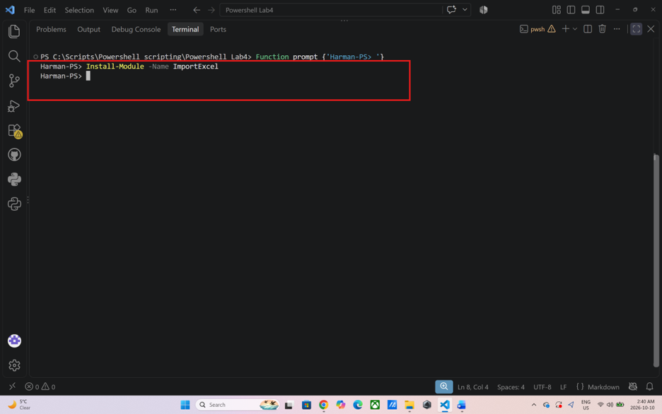
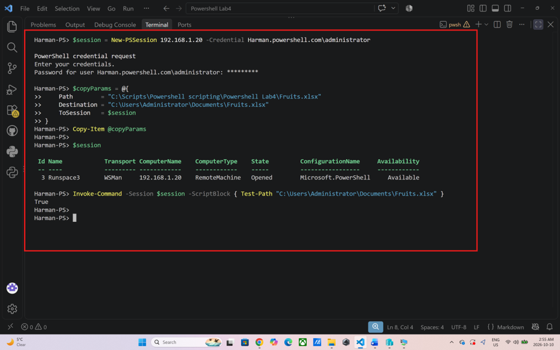
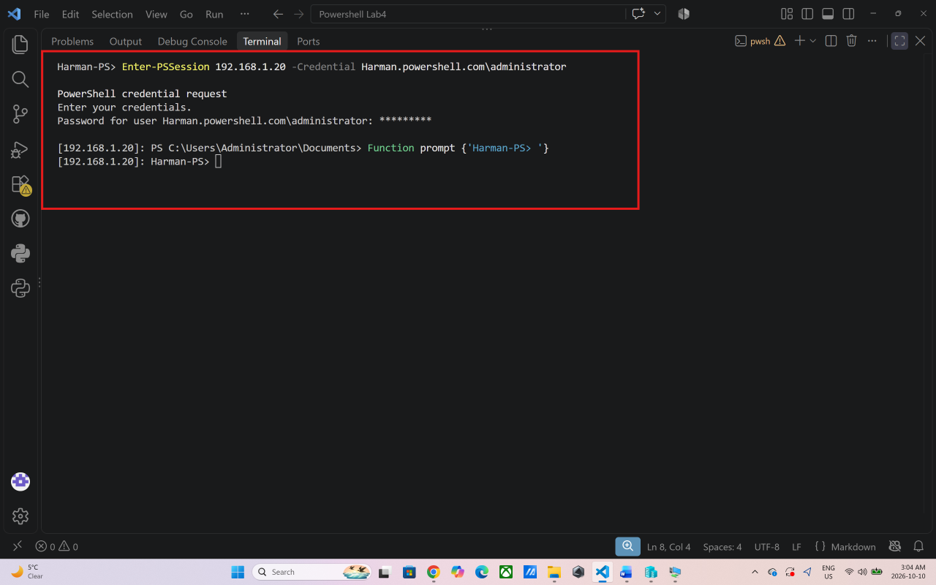
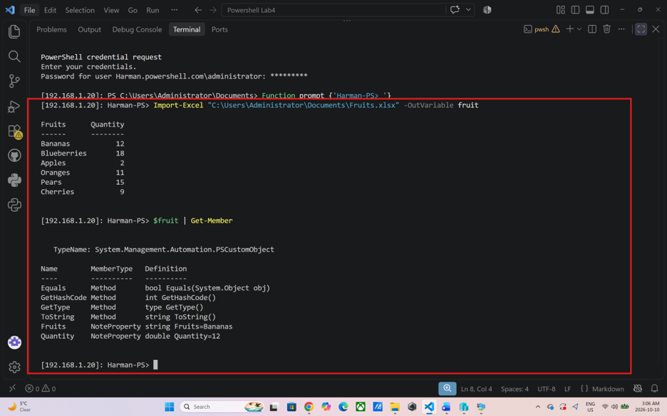
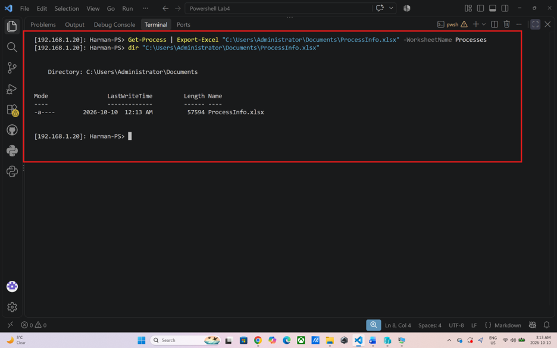
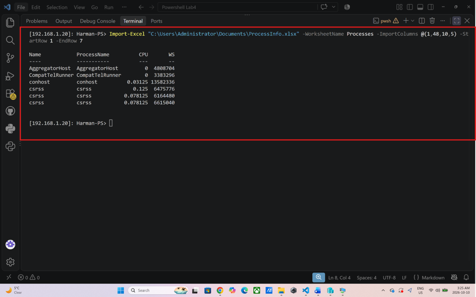
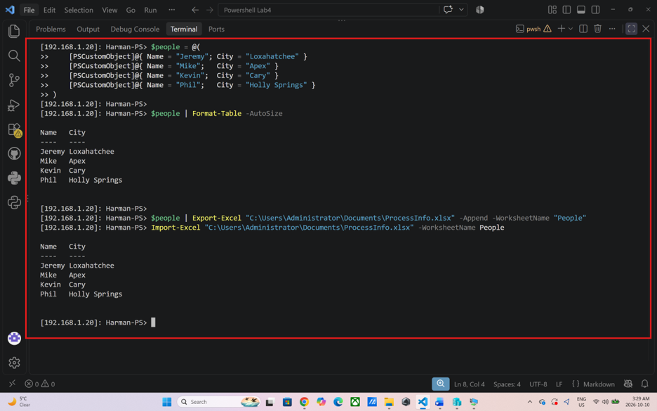
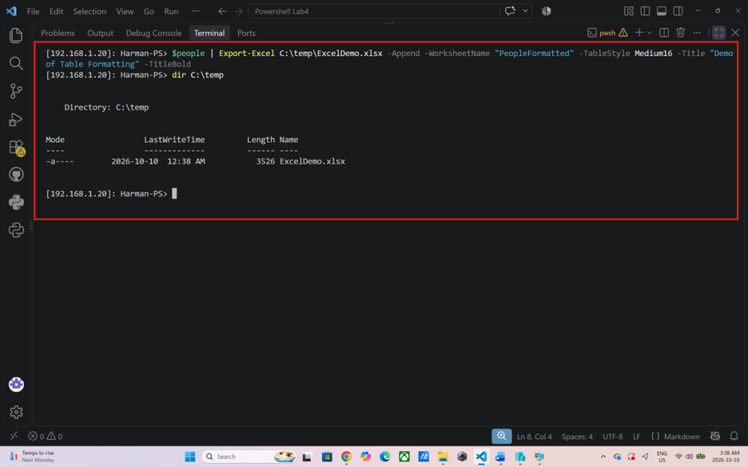
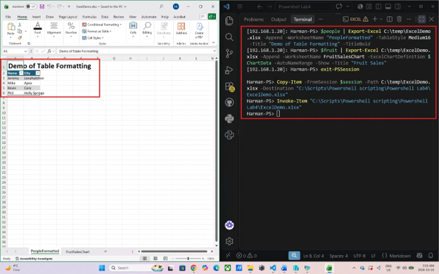
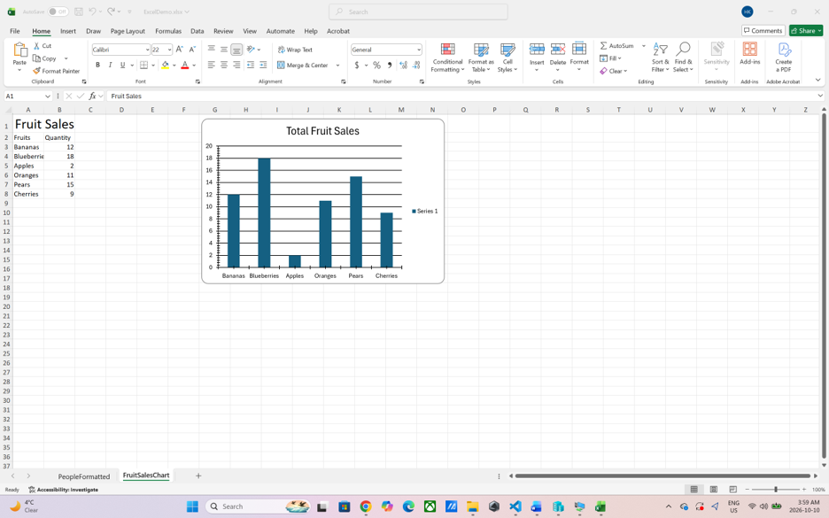

# Export and Import to and from Excel with the PowerShell Module ImportExcel

**Name:** Harmanpreet Kaur \
**Student ID:** 991855668 \
**Course:** SYST16023 MS PowerShell Scripting \
**Date:** October 10, 2026

---

In this lab I used a PowerShell module called **ImportExcel**. It lets me read data from Excel files and write data into them, and the best part is that Excel doesn't need to be installed. That matters on a server, since nobody wants to install Office on one just to make a report. I mainly used two cmdlets: `Import-Excel` and `Export-Excel`. The module also works on Linux and Mac, and in Azure Functions and GitHub Actions, so I think I'll actually use it at work.

## Install the module

I started by installing the module.

```powershell
Install-Module -Name ImportExcel
```



Excel is not needed for this to work, so it's safe to put on a server.


## Copy Fruits.xlsx to the server

I downloaded `Fruits.xlsx` from Slate, made a session to the server, and copied the file into the Administrator's Documents folder.

```powershell
$session = New-PSSession 192.168.1.20 -Credential Harman.powershell.com\administrator
$copyParams = @{
    Path        = "C:\Scripts\Powershell scripting\Powershell Lab4\Fruits.xlsx"
    Destination = "C:\Users\Administrator\Documents\Fruits.xlsx"
    ToSession   = $session
}
Copy-Item @copyParams
```



There's a space in my folder name ("Powershell scripting"), so the path has to be in quotes or the copy fails.


## Log in to the server

Then I logged in to the server so I could run everything else from there.

```powershell
Enter-PSSession 192.168.1.20 -Credential Harman.powershell.com\administrator
```



After this the prompt changed to show the server's address, so I knew I was on the server.


## Import data from Excel

Now I imported the file with `Import-Excel`. I used `-OutVariable fruit` to save the data in a variable called `fruit` so I could use it again later.

```powershell
Import-Excel "C:\Users\Administrator\Documents\Fruits.xlsx" -OutVariable fruit
```

The result is a simple table with rows and columns. Then I ran `Get-Member` to see what PowerShell turned it into.

```powershell
$fruit | Get-Member
```



Each row became a `PSCustomObject`, and each column became a note property. My table has two columns, so there are two note properties.


If a table is really big, I don't have to import all of it. The next sections show how.

## Export data to Excel

To get a big table to practice with, I exported the list of running processes to a new spreadsheet. I named the tab `Processes` with `-WorksheetName`. The lab's command leaves this out, so Excel would call the tab `Sheet1` and the import in the next section couldn't find it.

```powershell
Get-Process | Export-Excel "C:\Users\Administrator\Documents\ProcessInfo.xlsx" -WorksheetName Processes
```




## Import only some columns and rows

`ProcessInfo.xlsx` has a ton of columns. I could import everything and filter it afterwards, but I only wanted `Name`, `ProcessName`, `CPU` and memory (I used `WS`, the working set), and only 6 rows. For that I used `-ImportColumns`, `-StartRow` and `-EndRow`.

The lab uses the column numbers `1,46,12,6`, but those didn't match my file. When I ran it, I got `PrivateMemorySize64` and `ProductVersion` instead of `ProcessName` and `CPU`, because the column order depends on the Windows and PowerShell version. So I listed my own columns with their numbers first.

```powershell
$i = 0
(Import-Excel "C:\Users\Administrator\Documents\ProcessInfo.xlsx" -WorksheetName Processes -EndRow 2)[0].PSObject.Properties.Name | ForEach-Object { $i++; "$i  $_" }
```

In my file, `Name` is column 1, `WS` is 5, `CPU` is 10 and `ProcessName` is 48. The columns come out in the order I write the numbers, so to get Name, ProcessName, CPU, WS I wrote `1,48,10,5`.

```powershell
Import-Excel "C:\Users\Administrator\Documents\ProcessInfo.xlsx" -WorksheetName Processes -ImportColumns @(1,48,10,5) -StartRow 1 -EndRow 7
```




## Add data to an existing spreadsheet

`-Append` adds data to a spreadsheet that already exists. With `-WorksheetName` I can either add to an existing tab or make a new one by using a new name. I wanted a new tab called `People`, so I made a small table first.

```powershell
$people = @(
    [PSCustomObject]@{ Name = "Jeremy"; City = "Loxahatchee" }
    [PSCustomObject]@{ Name = "Mike";   City = "Apex" }
    [PSCustomObject]@{ Name = "Kevin";  City = "Cary" }
    [PSCustomObject]@{ Name = "Phil";   City = "Holly Springs" }
)

$people | Format-Table -AutoSize
```

Then I added it to the spreadsheet I already had.

```powershell
$people | Export-Excel "C:\Users\Administrator\Documents\ProcessInfo.xlsx" -Append -WorksheetName "People"
```




## Export with formatting

`Export-Excel` can also format the data while exporting. I only tried a couple of options, but there are a lot more in the parameter list.

```powershell
New-Item -Path C:\temp -ItemType Directory -Force

$people | Export-Excel C:\temp\ExcelDemo.xlsx -Append -WorksheetName "PeopleFormatted" -TableStyle Medium16 -Title "Demo of Table Formatting" -TitleBold
```






This gave the table a style (`Medium16`) and a bold title on top. The first line makes sure the `C:\temp` folder exists, because the export fails without it.


## Create a chart

For the chart, I first saved the settings in `$ChartData`: the X values, Y values, chart type and title. The lab uses `Item` and `TotalSold` as the column names, but my `Fruits.xlsx` has `Fruits` and `Quantity` (I checked with `$fruit | Format-Table`), so I used those.

```powershell
$ChartData = New-ExcelChartDefinition -XRange Fruits -YRange Quantity -ChartType ColumnClustered -Title "Total Fruit Sales"
```

Then I exported the data with the chart attached. The lab used `$data` here, but that variable was never created anywhere, so I used `$fruit` instead (the data I imported from `Fruits.xlsx`).

```powershell
$fruit | Export-Excel C:\temp\ExcelDemo.xlsx -Append -WorksheetName FruitSalesChart -ExcelChartDefinition $ChartData -AutoNameRange -Show -Title "Fruit Sales"
```



That made the chart. The `-Show` switch opens the spreadsheet when it's done.


---

## Reflection

In this lab I learned how to use the ImportExcel module to read and write Excel files from PowerShell without having Excel installed, which is very useful on a server. I imported a table into PowerShell and saw that each row became a PSCustomObject, so I can sort and filter it like any other PowerShell data. I exported running processes to a big spreadsheet and imported only the columns and rows I needed, added a new People tab with `-Append`, formatted a table with a style and a bold title, and built a column chart from the fruit data. I also practiced remote sessions with `New-PSSession`, `Enter-PSSession` and `Copy-Item`, and I learned how to publish a project to GitHub from VS Code.

I ran into a lot of problems, and most of them came from the lab instructions not matching my machine. My terminal opened in the wrong folder, and the space in `Powershell scripting` meant the copy path only worked inside quotes. The lab also had small mistakes: a missing space before `@` in `-ImportColumns`, an extra `'` on the `Enter-PSSession` line, and a code block that was never closed. The export command never named the worksheet, so I added `-WorksheetName Processes` so the import step could find it. The column numbers `1,46,12,6` gave me `PrivateMemorySize64` and `ProductVersion` instead of `ProcessName` and `CPU`, because the column order is different in my file. I listed my own columns with their numbers and used `1,48,10,5` instead. The chart command also used a `$data` variable that doesn't exist, which gave me warnings and no chart, and it used the column names `Item` and `TotalSold` when my table has `Fruits` and `Quantity`. I fixed it by using `$fruit` and my real column names.

I also made a few mistakes of my own. I typed a typo in the title, then ran the export again, and PowerShell warned that `-Title` is ignored when appending. The data was added a second time, so I had to delete `ExcelDemo.xlsx` with `Remove-Item` and run the commands again to get a clean file. Because `-Show` tries to open Excel on the server, nothing appeared on my screen, so I closed the session and copied the file back to my computer to open it there. My first screenshots also had spaces and a capital `.Png`, which would have shown up as broken images on GitHub, so I renamed them to lowercase with dashes in a `screenshots` folder. The biggest lesson was to read warnings and errors carefully, because each one told me something real, and not to trust column numbers or variable names from instructions without checking them against my own data.

